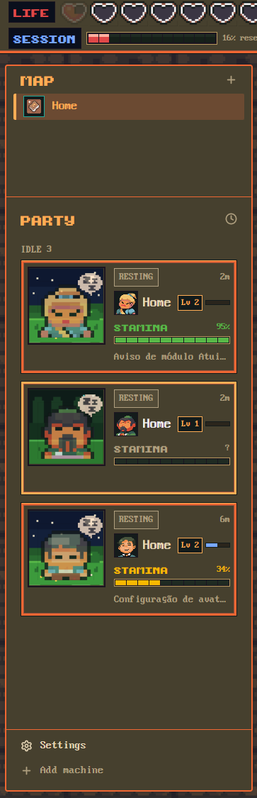

# Guildhall

A pixel-art adventurers' guild for [Herdr](https://herdr.dev). Your coding agents are a party of
heroes: each one gets a hero card with its own scene, stamina and level, the tabs are quests, the
spaces are places on a map, and a wood-framed HUD shows your Claude limits as hearts and a session bar.

## What's inside

- **HUD:** LIFE hearts for the weekly Claude limit (a quarter heart per 2.5%), a SESSION bar for the
  5-hour limit, a centered town sign with the space and tab, a day/night clock, and wood buttons
  (New tab, Split, Search).

- **Party:** a hero card per agent. It shows the hero in a scene, a status bubble (on a quest, needs
  you, quest done, resting), a STAMINA bar (the context left in that Claude session), and the
  hero's level. Click the portrait to pick another of 88 heroes.
- **Levels:** heroes earn 1 XP per finished task. Level N needs N tasks to reach N+1, up to level 100.
  Each hero keeps its own level.
- **Map, quests and tabs:** spaces show as places on a map, and tabs as quest plates with the hero's
  portrait. A quest board panel lists each tab's quests.
- **Overworld:** an optional strip at the bottom (Ctrl+Shift+J) where heroes walk, wait, cheer or
  rest. It has four maps: village, camp, snowfield and shrine.
- **Notifications:** RPG dialog boxes where the agent's hero speaks.
- **Command palette:** Ctrl+Shift+P opens the theme's commands first, with their keys, then Herdr's.
- **Sounds:** a fanfare when an agent finishes, an alert when one needs you, and a jingle on level up.

## Install

Ask your agent to add this layout from `herdr.dev/layouts`, or copy `layouts/`, `themes/` and `mods/`
into `~/.config/herdr-app/`. Then merge `keys.json` into yours and run
`herdr-app do layout.switch '{"name":"guildhall"}'`.

The STAMINA and SESSION bars and the LIFE hearts need the Claude Code status line in `extras/`. See
`extras/README.md`, which also shows how to turn on the sounds.

`RECIPE.md` describes the whole build in detail.

## Credits

- **Art, sounds and the NinjaAdventure font:** [Ninja Adventure Asset Pack](https://pixel-boy.itch.io/ninja-adventure-asset-pack)
  by **pixel-boy** and **AAA**. It is released under CC0 (public domain) and credit is not
  required. Thank you for this wonderful pack. The heroes, portraits, tilesets, wood UI, emotes,
  icons, hearts, flags, chests, fire, the pixel font and the sounds all come from it. Its license
  is included next to the files that use it.
- **PxPlus IBM VGA 8x16 font:** by **VileR** ([The Ultimate Oldschool PC Font Pack](https://int10h.org/oldschool-pc-fonts/)),
  under CC BY-SA 4.0. See `mods/guildhall-hud/fonts/LICENSE-PxPlus.txt`.
- **Inspiration:** [Pixelherd](https://github.com/jzetterman/herdr-pixelherd) by jzetterman (square
  hero cards) and [World of Codecraft](https://github.com/kevinpardo/world-of-codecraft) by Kevin
  Pardo (heroes that live in a world). No code was copied from either.
- **Herdr's own mods:** `guildhall-tabs`, `guildhall-spaces`, `guildhall-pane`, `guildhall-status`
  and `guildhall-agents` began as `mod.clone` copies of Herdr's shipped mods.

## License

The layout, theme and mod code are MIT (see `LICENSE`). The Ninja Adventure assets stay CC0 and the
PxPlus font stays CC BY-SA 4.0.
