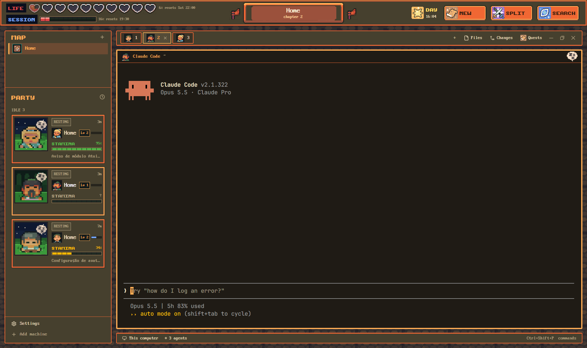
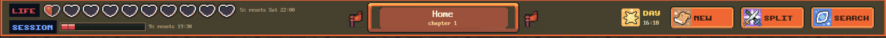
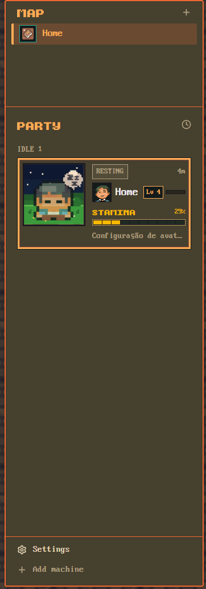
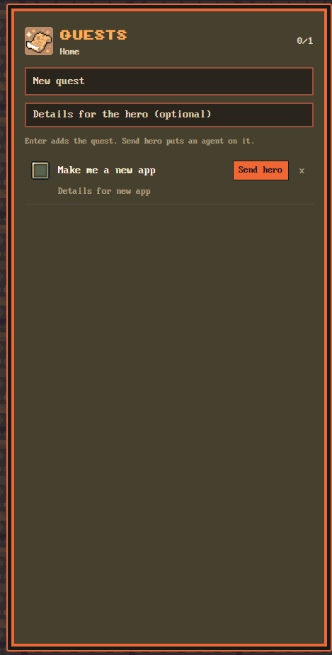
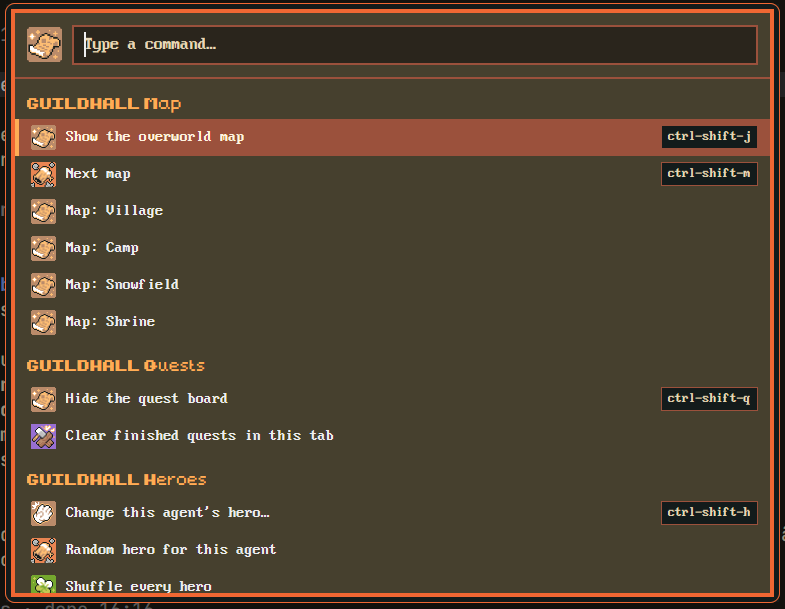
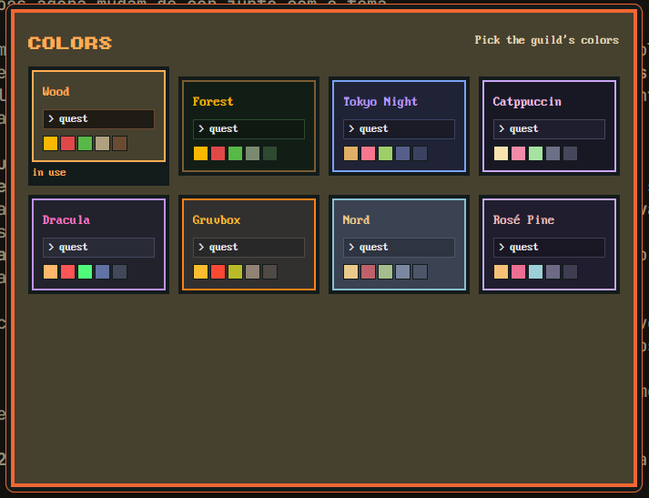

# Guildhall

A pixel-art adventurers' guild for [Herdr](https://herdr.dev). Your coding agents become a party of
heroes. Each hero has a card with its own scene, stamina and level. Tabs are quests, spaces are places
on a map, and a wood-framed HUD shows your Claude limits as hearts and a session bar.

## The HUD

- **LIFE:** 10 hearts show the Claude **weekly** limit you have left. Each heart is 10% and each
  quarter is 2.5%, rounded up, so the hearts only empty at 0%. With one heart or less left, it blinks.
- **SESSION:** a bar for the **5-hour** limit, with the time it resets.
- **Town sign:** sits in the middle of the window and shows the space and the current tab ("chapter").
- **Clock:** the sun or the moon, with the time. The wood darkens at night.
- **Buttons:** NEW (new tab), SPLIT and SEARCH.

## The party

<table>
<tr>
<td width="50%" valign="top">

</td>
<td width="50%" valign="top">

Every agent is a hero with a card:

- **A scene** with the hero, posed by status: walking while it works, arms up when it needs you or
  is done, standing at rest. A speech bubble shows the status too.
- **A status plate** for each state: ON A QUEST, NEEDS YOU, QUEST DONE or RESTING.
- **STAMINA:** the context left in that Claude session. It drains as the chat grows and refills
  after `/compact`.
- **A level:** heroes earn 1 XP for every answer they finish. Level N needs N more to reach N+1
  (1, 2, 3, …), up to level 100. A jingle plays on every level up, and each hero keeps its own level.
- **88 heroes:** click the small portrait to pick another one, or use Ctrl+Shift+H.

The **MAP** above the party lists your spaces as places, each marked with an icon.

</td>
</tr>
</table>

## Quests

<table>
<tr>
<td width="50%" valign="top">

Open the **Quests** board from the tab bar or with Ctrl+Shift+Q.

- Write a quest and, if you like, **details for the hero**: what to do, which files, when it counts
  as done.
- **Send hero** opens a new tab named after the quest. An agent starts there with the quest as its
  first message.
- The quest then shows the hero working on it and its status. Click the hero to jump there.
- When the hero finishes, the quest ticks itself. You can also tick a quest by hand.

Each space has its own board, so a quest stays in view after its tab opens.

</td>
<td width="50%" valign="top">

</td>
</tr>
</table>

## Commands and keys

**Ctrl+Shift+P** opens the Guildhall palette. The theme's commands come first, with their keys, and
Herdr's own commands follow. Type to filter, then press Enter to run one.

| Key | Command |
|---|---|
| Ctrl+Shift+P | Guildhall command palette |
| Ctrl+Shift+Q | Show or hide the quest board |
| Ctrl+Shift+H | Change this agent's hero |
| Ctrl+Shift+U | Go to the next agent that needs you |
| Ctrl+Shift+J | Show or hide the overworld map |
| Ctrl+Shift+M | Next map |
| Ctrl+Shift+Y | Show or hide the HUD |
| Ctrl+Shift+B | Show or hide the side bar |
| Ctrl+Shift+G | Pick the theme colors |
| Ctrl+Shift+D | Open a WSL project |
| Ctrl+Shift+I | New WSL tab here |
| Middle click | Close a tab, a space on the MAP, or dismiss a hero (asks first when needed) |

## Colors

Press **Ctrl+Shift+G**, or pick "Change the theme colors…" in the palette, to choose the guild's
colors: Wood (the default), Forest, Tokyo Night, Catppuccin, Dracula, Gruvbox, Nord or Rosé Pine.
The frames, cards and panels take the palette's colors, and the sign and the buttons are recolored
to match. The hearts stay red and the maps keep their own colors.

## WSL

On Windows, Guildhall works with your WSL distro (the default one):

- **Ctrl+Shift+D** lists the folders in your Linux home. **Open** makes one a space with a WSL
  shell in it, and **Hero** does the same with Claude Code running there. The MAP marks those spaces
  "WSL".
- In a WSL space, the **NEW** button and **Ctrl+Shift+I** open WSL terminals in its folder, and the
  quest board sends heroes to work in WSL.
- Agents in WSL fill the STAMINA, SESSION and LIFE bars too. That needs Claude Code installed in
  WSL and the Linux status line from `extras/` (see `extras/README.md`).

## More

- **Overworld:** an optional strip at the bottom of the window where heroes walk the road, wait at
  a door, cheer by a chest or rest by the campfire. There are four maps: village, camp, snowfield
  and shrine.
- **Notifications:** they appear as RPG dialog boxes, with the agent's hero speaking.
- **Tabs and panes:** tabs are quest plates, and each terminal header shows its hero and status.
- **Sounds:** a fanfare when an agent finishes, an alert when one needs you, and a jingle on level up.

## Install

Ask your agent to add this layout from `herdr.dev/layouts`, or copy `layouts/`, `themes/` and `mods/`
into `~/.config/herdr-app/`. Then merge `keys.json` into yours and run
`herdr-app do layout.switch '{"name":"guildhall"}'`.

The LIFE hearts and the SESSION and STAMINA bars read Claude's limits through a Claude Code status
line, which lives in `extras/`. `extras/README.md` shows how to set it up and how to turn on the
sounds.

`RECIPE.md` describes the whole build in detail.

## Credits

- **Art, sounds and the NinjaAdventure font:** [Ninja Adventure Asset Pack](https://pixel-boy.itch.io/ninja-adventure-asset-pack)
  by **pixel-boy** and **AAA**. It is released under CC0 (public domain), so credit is not
  required, but thank you for this wonderful pack. Everything below comes from it: the heroes,
  portraits, tilesets, wood UI, emotes, icons, hearts, flags, chests, fire, the pixel font and the
  sounds. Its license is included next to the files that use it.
- **PxPlus IBM VGA 8x16 font:** by **VileR** ([The Ultimate Oldschool PC Font Pack](https://int10h.org/oldschool-pc-fonts/)),
  under CC BY-SA 4.0. See `mods/guildhall-hud/fonts/LICENSE-PxPlus.txt`.
- **Inspiration:** [Pixelherd](https://github.com/jzetterman/herdr-pixelherd) by jzetterman, for
  the square hero cards, and [World of Codecraft](https://github.com/kevinpardo/world-of-codecraft)
  by Kevin Pardo, for heroes that live in a world. No code was copied from either.
- **Herdr's own mods:** `guildhall-tabs`, `guildhall-spaces`, `guildhall-pane`, `guildhall-status`
  and `guildhall-agents` began as `mod.clone` copies of Herdr's shipped mods.

## License

The layout, theme and mod code are MIT (see `LICENSE`). The Ninja Adventure assets stay CC0, and
the PxPlus font stays CC BY-SA 4.0.
