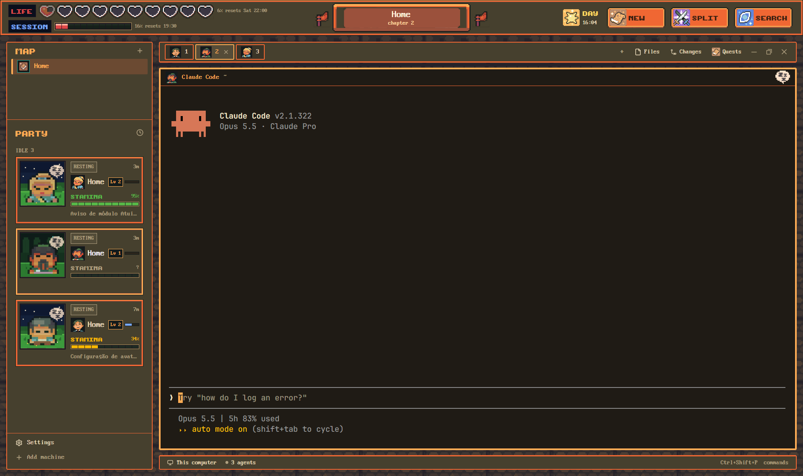

# Guildhall

An 8-bit adventure for your terminals. A pixel night forest sits behind everything. Across the top runs an adventure HUD: one life heart per agent, a stamina bar, a parchment banner naming the current space, and round action buttons. Agents line up on the left as a party of original 40px pixel heroes, and notifications arrive as RPG dialog boxes. All art is original.

**What you see**

- **Background:** `mods/guildhall-hud/ui/backdrop.png` (cover): the dark cobblestone floor of the Ninja Adventure pack (CC0), tiled to 640x360, dimmed, drawn 3x (built by `src/backdrop.ps1`). Terminals sit at opacity 0.86.
- **HUD, 68px, full width** (`guildhall-hud`, `window_drag`). The bar is `chrome` with a 2px `border` underline.
  - Left: "LIFE" with 24px pixel hearts, one per agent. There are at least 3 slots and at most 10, then `+N`.
  - Below that: "STAMINA", a 12-segment bar that fills green with the share of agents working, plus a blinking `! N` when agents need you.
  - Center: a hanging wooden sign (`art/sign.svg`, 128×32 drawn at 2x, with planks, grain, iron brackets, nails and chains) with the space name ("Home" for `~`) and `chapter <tab>`.
  - Right: three 40px gem buttons with pixel item icons: NEW (chest, `tab.new`), SPLIT (crossed swords, `pane.split right`), SEARCH (spyglass, opens `picker`).
- **World row** (12px padding and gap) under the HUD:
  - Sidebar, 280px: `chrome`, a 2px `border`, radius 3. It holds `spaces` (weight 2), `guildhall-agents` (weight 3, titled "PARTY") and the `workspace-chrome` footer (69px).
  - Work column, with a 10px gap: `tabs` (40px framed bar), the panes, and `workspace-status` (28px framed bar).
- **Panes:** radius 3, a 2px bronze `border` (`#7a5c34`), a 3px gold focus (`#f8b800`), and the shipped `pane` header (32px). There is also the hidden `files`/`changes` panel, 368px.
- **Fonts:** UI uses PxPlus IBM VGA 8x16, bundled in `mods/guildhall-hud/fonts`. Terminals use JetBrains Mono 15.
- **Theme** `themes/guildhall.json`: wood from the Ninja Adventure "Theme Wood" (CC0): chrome `#46402e`, border (rim) `#f06733`, accent (shine) `#ffad55`, terminal background `#1f1b15`, parchment text `#f0e6c8`. Status colors are working `#f8b800`, blocked `#e04848`, done `#58b848`, idle `#b0a080`.

**How it behaves**

- **Hero per agent:** a hash of the address picks one of hunter, princess, knight, sorcerer, sage, monk, ranger or scout, from the Ninja Adventure Asset Pack by pixel-boy (CC0, `heroes/LICENSE-NinjaAdventure.txt`). It stays the same across restarts. Each agent is a square card: an 88px scene (meadow, forest, castle or dungeon) with the 64px full-body sprite, then a status badge, a 26px portrait with the name, and the space and tab. Sub-agents and the folded rail show the portrait.
  - working: walks (frames walk1 and walk3 cross-fade linearly over 520ms, with a 3px hop).
  - blocked/error: arms raised (item pose) with a blinking red "!" badge.
  - done: arms raised with a pulsing gold star.
  - idle: lies down to rest (dead pose), dimmed to 0.7, with a "z" floating up.
- **Hearts:**
  - working: red, beating.
  - blocked: red, flashing fast.
  - done: gold.
  - idle: empty.
  - Clicking a heart focuses that agent's pane.
- **Toasts** (`guildhall-toast`, set with the root `toast`): a `#0a0f1c` box with a 2px parchment inner frame and a 26px star or heart icon. The title is gold, the body is parchment, and a ▼ blinks. Clicking runs the action and closes the toast.

**Built from**

- `layouts/guildhall.json`: root `column` → `hud` block + `world` row → `sidebar` column + `work` column. Root sets `titlebar: none`, `toast`, `theme`, `ui_font`, `background.image`, `preview`.
- `guildhall-agents`: a `mod.clone` of the shipped `agents`. Its `avatar()` is replaced, it uses bigger rows and pixel-font headers. Sprites are generated from `avatar/src/*.txt` (a palette line, then 16 rows of 16 characters) by `sh avatar/src/build.sh`.
- `guildhall-hud`: uses `agents()`, `spaces()`, `focused()`, `run()`. It has no timers; all animation is `.loop()`.
- `guildhall-toast`: `props()` and `closeOverlay()`.
- Shipped mods: `spaces`, `tabs`, `pane`, `files`, `changes`, `workspace-status`, `workspace-chrome` (footer), `picker`.

**Watch out**

- Buttons inside the `window_drag` HUD must stop `mouse_down`, or the press drags the window.
- With `titlebar: none` on Windows/Linux, the shipped `tabs` bar draws the window buttons. Don't add a second set in the HUD.
- Use `image()` for sprites. `svg()` tints them a single color.
- PxPlus is CC BY-SA 4.0 (VileR, int10h.org). Keep `LICENSE-PxPlus.txt` next to it.
- Keep the art original: no existing game characters, logos or symbols.

**Done when**

- `herdr-app check` passes for all three mods, and `layout.switch {"name":"guildhall"}` shows no errors in `herdr-app status`.
- The HUD shows one heart per agent, and the stamina bar fills as agents work.
- A blocked agent flashes its heart, the "!" badge and the HUD counter.
- A notification shows as a dialog box with a blinking ▼.

## Overworld (added)

- **What you see:** a 184px framed strip under the terminals (`guildhall-world`). It shows `world.png`, a 480x60 scene drawn 3x (grass, a dirt road, a back row of trees, bushes, a tent and a stone fire pit), built by `src/compose.ps1` from Ninja Adventure tiles (CC0). An animated campfire (two flame frames cross-fading) sits on the pit, and an "OVERWORLD" plate is in the corner.
- **How it behaves:** every agent's hero is a 64px sprite (the same hero as on its card) placed by status. Working heroes walk the road, sliding left and right on a `left` loop with walking frames and a hop. Blocked heroes stand on the left with a blinking "!" sign. Done heroes cheer by the tent with a bobbing gold star. Idle heroes lie by the fire with a floating "z". Clicking a hero focuses its pane.
- **Watch out:** create `mod.json` (`"place": "none"`) before `main.js`. Otherwise Herdr docks a copy of the new mod and wraps the layout root in a new row, and the root's look (theme, fonts, background, toast) stops applying.

## Added in Guildhall

- **Life rounds up:** hearts show the weekly limit left rounded up to the next quarter (12% = 1 heart and a quarter), so they are empty only at 0%.
- **Pick a hero:** click the small portrait on a PARTY card to open `guildhall-picker`, a grid of all 88 heroes (`heroes/`, built by `guildhall-agents/src/heroes.ps1`). The pick is saved in shared `guildhall.heroes` ({ address: hero }), and every mod's `hero()` reads it before falling back to the address hash. "Random" removes the pick.
- **Idle:** idle heroes stand facing you and breathe (a 1px `top` loop), with the "Zz" bubble. Do not stack poses and swing their opacity below 0: Herdr does not hide them, so they show through each other.
- **XP and levels, per hero:** each time an agent goes from working to idle, the hero it plays earns 1 XP. XP is kept per hero (shared `guildhall.xp` = { hero: xp }), so a hero keeps its level on any agent and after a hero change. Older per-terminal entries ("t5") move to that terminal's hero on start. Level N needs N quests to reach N+1 (1, 2, 3, ...), up to level 100 ("Lv MAX"): reaching level L takes (L-1)L/2 quests (level 10 = 45, level 100 = 4950). The card shows the hero's "Lv N", a bar of the way to the next level and a tooltip "x/N quests to level N+1", the picker marks heroes with XP ("Lv N" on the portrait and the XP in the header), and a level-up plays `ui/sounds/levelup.wav`.
- **Day and night:** the HUD shows the pack's sun (06:00-19:00) or moon with the time, and the wood darkens at night (a 1-minute timer).
- **Quest board:** `guildhall-quests` is a third side panel (stack child `quests`), opened by the Quests button in the tab bar. It holds the shown **space's** quests (shared `guildhall.quests` = { spaceId: [...] }; older per-tab boards move to their tab's space). Each quest has a title and optional details. **Send hero** runs `tab.new { name, space, argv: ["claude"], task }`: a new tab named after the quest, where the agent gets the title and details as its first message. The row then shows that tab's hero portrait and status emote (click to go there). A 3-second check resolves the tab by name, notes when the agent starts working, and ticks the quest when it then goes idle or done. Tick by hand, or press x to remove.

## Commands and maps

- **Command palette** (`guildhall-palette`, bound to Ctrl+Shift+P in the `layout:guildhall` key section and opened by the status bar hint, `guildhall-status`, a clone of `workspace-status`): a wood-framed list. The Guildhall commands come first, in their own groups:
  - Map: show or hide the overworld, next map, or pick a map.
  - Quests: show or hide the quest board, clear finished quests.
  - Heroes: change this agent's hero, random hero, shuffle every hero, forget picks, reset XP, go to the next agent that needs you.
  - Window: show or hide the side bar or the HUD.
  Herdr's base commands follow. Typing filters, Up/Down moves, Enter runs, Esc closes.
- **Maps:** the overworld is now 118px tall and shows one of four 800x56 maps drawn 2x (village, camp, snowfield, shrine), built by `guildhall-world/src/maps.ps1` from the pack's house, tower, camp and nature tiles. Every map has the same landmarks: a door on the left (needs you), the road (working), an open chest (done) and a fire pit (idle). Heroes are 32px. The map plate cycles maps, and the choice is kept in shared `guildhall.map`.
- **Theme keys** (`keys.json`, `layout:guildhall` section):
  - Ctrl+Shift+J: map.
  - Ctrl+Shift+M: next map.
  - Ctrl+Shift+Q: quest board.
  - Ctrl+Shift+H: change hero.
  - Ctrl+Shift+U: next agent that needs you.
  - Ctrl+Shift+Y: HUD.
  - Ctrl+Shift+P: palette.
  The commands that run code go to `guildhall-hud.<command>` (`next-map`, `quests`, `pick-hero`, `needs-you`); the HUD answers them through `nextCommand()` because it is always shown. Palette entries name their key action in `bind`, and the palette shows the matching key, with the `layout:guildhall` section winning over `global`.

## Credits

Art, sounds and the NinjaAdventure font: Ninja Adventure Asset Pack by pixel-boy and AAA (CC0), https://pixel-boy.itch.io/ninja-adventure-asset-pack. PxPlus IBM VGA 8x16 font: VileR, int10h.org (CC BY-SA 4.0). Inspired by Pixelherd (jzetterman) and World of Codecraft (Kevin Pardo).

## Theme colors

- **Themes:** `themes/guildhall-*.json` holds seven more palettes besides `guildhall` (Wood): forest (the first green-and-gold look), tokyo, catppuccin, dracula, gruvbox, nord and rosepine.
- **The picker:** `guildhall-themes` shows each `guildhall*` theme as a small framed card in its own colors. Clicking a card runs `app.theme {name}`. It opens with Ctrl+Shift+G or from the palette ("Change the theme colors…").
- **Wood follows the theme:** every Guildhall mod reads the wood colors from the theme through getters. The rim is `border`, the shine `accent`, the bevel `selected` and the fill `chrome`, and the night HUD uses `canvas`. Only the outline stays `#131b1b`.
- **Recolored wood:** `guildhall-hud/src/recolor.ps1` makes a copy of the sign, its inset and the three button states for every `guildhall-*` theme (`ui/wood/<theme>/`). It maps each pixel by brightness onto the theme's darks, rim (`border`) and shine (`accent`), and keeps the sign's inset in the dark range so its text stays readable. The HUD picks the set for the theme in use and finds that theme by its colors, because Herdr's theme picker keeps its choice apart from `layout().theme`. The hearts and the maps keep the pack's colors.

## WSL

- **Starting WSL terminals:** `guildhall-wsl/wsl.js` exports `wslArgv(dir, command)`, which returns `["cmd.exe", "/c", "set WSLENV=HC_TERMINAL_ID/u&& wsl.exe --cd \"<dir>\" [-e bash -lic \"<command>; exec bash -li\"]"]`. It uses the default distro. WSLENV passes Herdr's terminal id into WSL, and the login-interactive bash loads `~/.bashrc`, which puts `~/.local/bin` (where Claude Code installs) on PATH. `guildhall-hud`, `guildhall-quests` and `guildhall-palette` carry the same copy.
- **The projects window:** `guildhall-wsl` runs `wsl.exe -e sh -c` to list `$HOME` and its folders. Open and Hero run `space.new { name, argv }`. The window stays open until the new space appears, because closing would end its task, and then records it in shared `guildhall.wsl` ({ spaceId: dir }).
- **WSL spaces:** in a WSL space, the HUD's NEW button (and `guildhall-hud.wsl-tab`, Ctrl+Shift+I) opens `wslArgv(dir)`, and the quest board's Send hero uses `wslArgv(dir, "claude")`. The MAP shows a "WSL" plate. The palette has a WSL group: open a project, new WSL tab, send a hero to WSL.
- **Stamina in WSL:** `extras/guildhall-statusline.sh` is the Linux status line. It parses JSON with grep and sed and writes `$WINDOWS_HOME/.guildhall/stamina/<HC_TERMINAL_ID>.json` through `/mnt/c`.
- **Watch out:** on Windows, Herdr starts `argv` through the user's PowerShell, so `hc ls` shows the terminal as `pwsh.exe`. The command still runs. The first call into a stopped distro can take several seconds.
